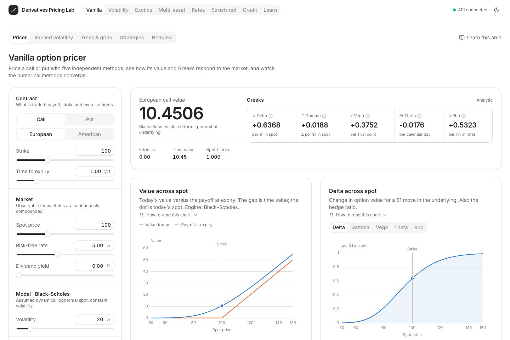
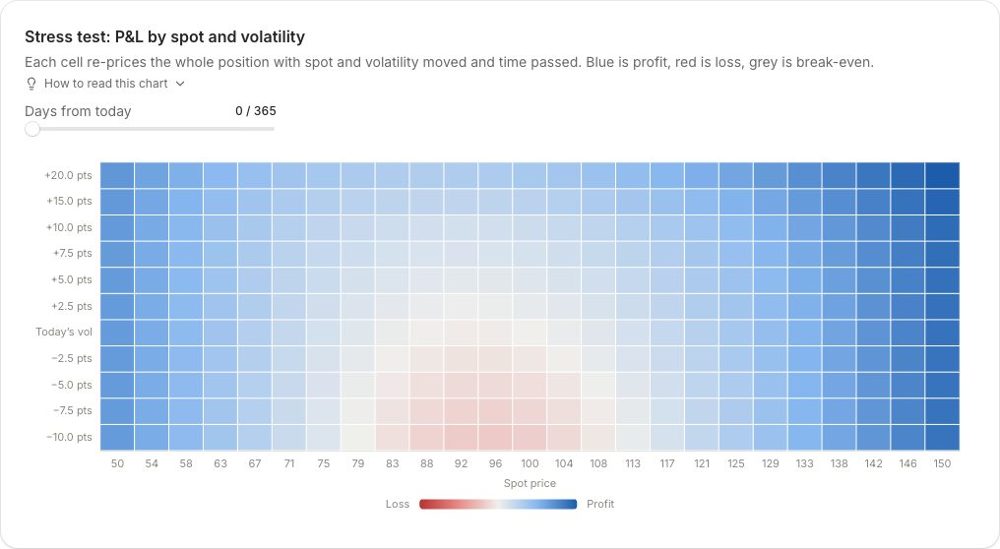
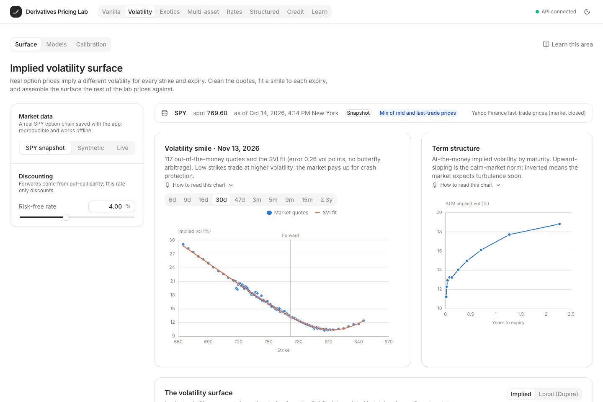
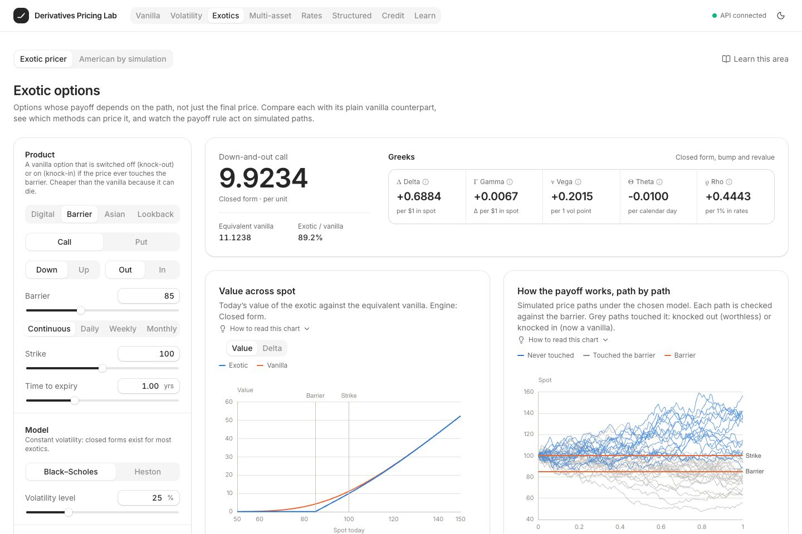
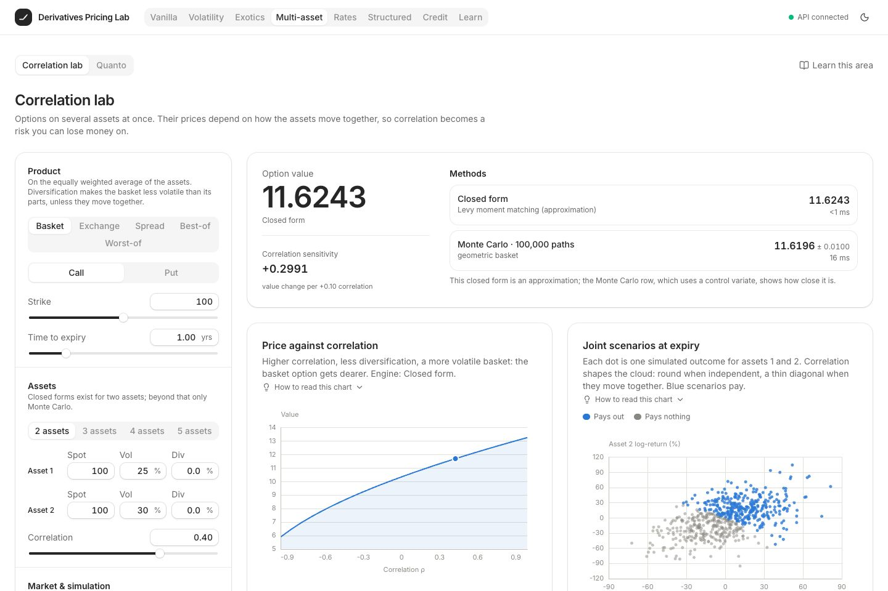
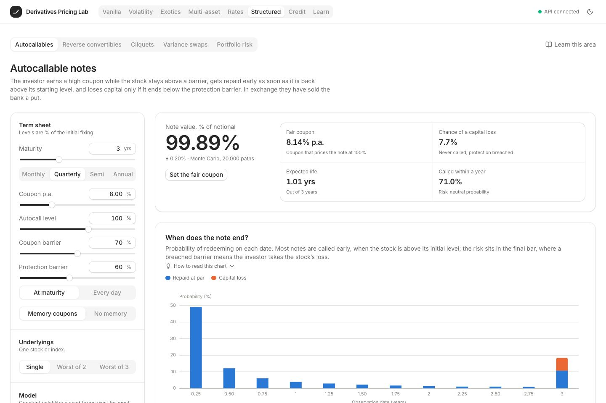
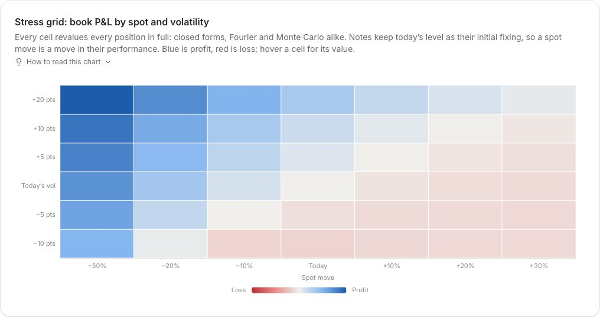
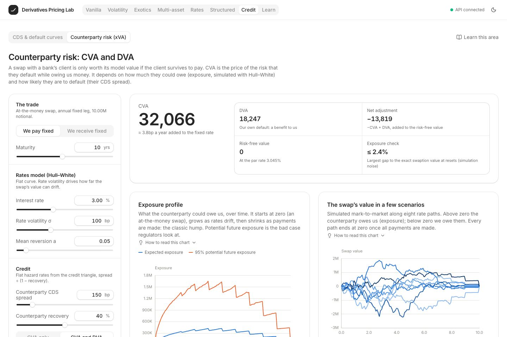
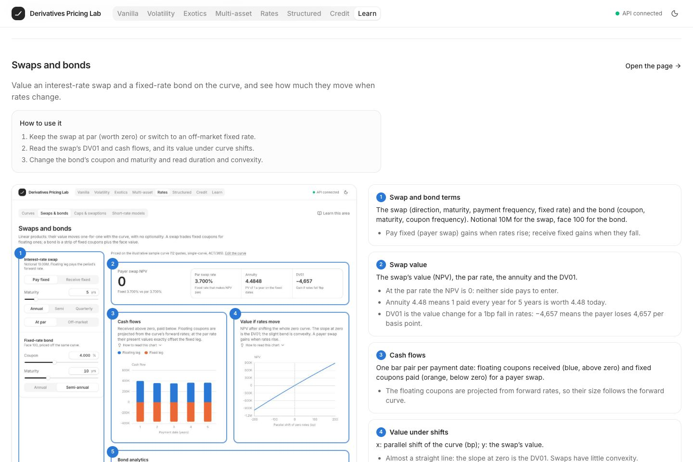

# Derivatives Pricing Lab

An interactive lab for **pricing, risk-managing and understanding derivatives**. It covers
vanilla equity options, volatility surfaces, exotic, multi-asset and structured products,
interest-rate derivatives and counterparty credit risk. Every number is computed by a tested
Python pricing library, served by a FastAPI backend and explored through a React web app, and
an in-app course teaches how to read every page.


> **Educational research tool.** Nothing here is investment advice. Prices depend on models and
> assumptions; probabilities shown are risk-neutral (pricing) probabilities, not forecasts; most
> market data is illustrative or clearly labelled as synthetic.

The project is built around one question:

> **What is a derivative worth, why, and how confident should we be in that number?**

Answering it takes more than one formula:
- **Several independent methods:** closed forms, trees, PDE grids, Monte Carlo and Fourier
  methods price the same contract and must agree within their numerical error.
- **Several models:** Black–Scholes, Heston, Merton, SABR, local volatility, Vasicek and
  Hull–White are compared to expose **model risk**.
- **External validation:** results are cross-checked against **QuantLib**, the industry's
  reference open-source library.

---

## Contents

- [Application overview](#application-overview)
- Areas: [Vanilla](#1-vanilla-options) · [Volatility](#2-volatility-beyond-a-constant) ·
  [Exotics](#3-exotic-options) · [Multi-asset](#4-multi-asset-options-and-correlation) ·
  [Rates](#5-interest-rate-derivatives) · [Structured](#6-structured-products-and-portfolio-risk) ·
  [Credit](#7-credit-and-counterparty-risk) · [Learn](#8-learn-an-in-app-course)
- [Correctness and validation](#correctness-and-validation)
- [Architecture](#architecture)
- [Technology](#technology)
- [Getting started](#getting-started)
- [API](#api)
- [Documentation](#documentation)
- [Methodological notes and limitations](#methodological-notes-and-limitations)
- [How the project was built](#how-the-project-was-built)

---

## Application overview

<p align="center">
  
</p>

The app has **seven product areas with 23 interactive pages, plus a Learn course**. Every page
shares one layout: inputs on the left, the headline result at the top, then charts and tables
explaining where the result comes from. Results recompute live as inputs change.

| Area | Pages | Research question |
|---|---|---|
| **Vanilla** | Pricer · Implied volatility · Trees & grids · Strategies · Hedging | What is a call or put worth, how sensitive is it, and how well can it be hedged? |
| **Volatility** | Surface · Models · Calibration | What volatility does the market imply at each strike and expiry, and which model can reproduce it? |
| **Exotics** | Exotic pricer · American by simulation | How do path-dependent payoffs change value, and which methods can price them? |
| **Multi-asset** | Correlation lab · Quanto | How does correlation between assets (or with a currency) move a price? |
| **Rates** | Curves · Swaps & bonds · Caps & swaptions · Short-rate models | How are rate products priced from one curve, and what does optionality on rates cost? |
| **Structured** | Autocallables · Reverse convertibles · Cliquets · Variance swaps · Portfolio risk | What are popular investor notes made of, and how does a book of them behave under stress? |
| **Credit** | CDS & default curves · Counterparty risk (xVA) | What default probabilities do spreads imply, and what does counterparty default risk cost? |
| **Learn** | Start here · 7 chapters · Glossary | How do you read and use every page, and what is the theory behind it? |

---

## 1. Vanilla options

The foundation: one call or put, priced five independent ways.

- **Pricer.**
  - Value, intrinsic and time value, and all five Greeks with their units (delta, gamma, vega,
    theta, rho), each plotted across spot.
  - A method table compares the Black–Scholes closed form, CRR and Leisen–Reimer trees, a
    Crank–Nicolson PDE grid, and Monte Carlo with a 95% interval.
  - Convergence studies show how fast each method converges and at what cost.
- **Implied volatility.** Brent's method inverts Black–Scholes within no-arbitrage bounds; the
  page shows the price-against-volatility curve the solver inverts.
- **Trees & grids.** Looks inside the numerical methods:
  - a binomial tree node by node (CRR, Jarrow–Rudd, Leisen–Reimer), with early-exercise nodes
    highlighted;
  - PDE solution slices as expiry approaches;
  - the American put's early-exercise boundary.
- **Strategies.** Eleven presets (straddles, spreads, condors, calendars…) plus a free leg
  editor (including American legs and shares). Shows:
  - net debit or credit, maximum profit and loss, breakevens and position Greeks;
  - P&L at the horizon and today;
  - a spot × volatility × time stress heatmap.
- **Hedging.** A discrete delta-hedging simulator with re-balancing frequency, transaction
  costs and volatility misspecification. The hedging error falls like 1/√N, matching the
  Derman–Kamal prediction.

Under the hood:
- Monte Carlo gives pathwise Greeks (Δ, ν, ρ, Θ) and likelihood-ratio gamma, with antithetic
  sampling and control variates.
- The PDE uses Rannacher start-up smoothing and prices American exercise with a penalty method.

<p align="center">
  
</p>

## 2. Volatility beyond a constant

Real option prices imply a different volatility at every strike and expiry.

- **Surface.** Three data sources:
  - a bundled **SPY option chain** (real, reproducible offline);
  - **synthetic** Heston chains, always labelled as such;
  - a **live** Yahoo Finance download.

  Quotes are cleaned: stale trades and wings are removed, forwards come from put–call parity,
  and out-of-the-money options are selected. Each expiry gets an **SVI** smile fit, checked for
  butterfly and calendar arbitrage. The page then shows:
  - a term structure chart;
  - a rotatable 3D implied-volatility surface;
  - the **Dupire local-volatility** surface derived from it.
- **Models.** A playground for Black–Scholes, **Heston** (stochastic volatility), **Merton**
  (jumps) and **SABR**. Each shows the smile it implies across expiries and its risk-neutral
  price density, computed by the **COS Fourier method**.
- **Calibration.** Fits Heston to the whole surface (vega-scaled least squares, about 1 s) or
  SABR per expiry. Shows the parameters, RMSE in volatility points, a Feller-condition check,
  and market-vs-model small multiples for every expiry.

<p align="center">
  
</p>

## 3. Exotic options

Payoffs that depend on the price path, not just its end point.

- **Products:**
  - digitals (cash or asset);
  - barriers (all eight types, continuous or discrete monitoring);
  - Asians (arithmetic or geometric, fixed or floating strike);
  - lookbacks.
- **Methods:**
  - Haug closed forms, including the Broadie–Glasserman–Kou correction for discrete barriers;
  - PDE grids ending on the barrier, with knock-ins by in–out parity;
  - Monte Carlo under any model, with Brownian-bridge barrier crossing and a geometric-Asian
    control variate.
- **Model risk.** The same exotic is priced under Black–Scholes and Heston at the same
  volatility level, and simulated paths show the payoff rule acting path by path.
- **American by simulation.** The **Longstaff–Schwartz** regression method is compared with the
  tree and the exact PDE exercise boundary, and works under any model.

<p align="center">
  
</p>

## 4. Multi-asset options and correlation

- **Correlation lab.** Exchange, spread, basket, best-of and worst-of options on 2–5 correlated
  assets (Cholesky-correlated GBM). Methods:
  - **Margrabe**, **Kirk**, **Levy** moment matching and **Stulz** closed forms, using Genz's
    bivariate normal CDF;
  - Monte Carlo with a geometric-basket control variate.

  The page shows the correlation sensitivity, the price-against-correlation curve and a
  joint-scenario scatter.
- **Quanto.** An option on a foreign asset paid at a fixed exchange rate. Shows the drift
  adjustment −ρσ_Sσ_FX, checked by a joint asset-and-FX Monte Carlo.

<p align="center">
  
</p>

## 5. Interest-rate derivatives

Every Rates page prices off **one shared, editable curve**: change a quote and everything
reprices.

- **Curves.** Bootstraps the discount curve from deposits, FRAs and par swaps (log-linear
  discount factors, repricing errors ~1e-16). Shows zero, forward and discount curves, with
  parallel shifts.
- **Swaps & bonds:**
  - swap NPV, par rate, annuity, DV01, projected cash flows and value under curve shifts;
  - bond price, yield, Macaulay and modified duration, convexity, and the price–yield curve
    against its duration and convexity approximations.
- **Caps & swaptions.** Priced under **Black-76** and **Bachelier** (normal), with the
  equivalent volatility in the other model, the caplet strip, and the smile each model implies.
- **Short-rate models:**
  - **Vasicek** and **Hull–White** rate fans and their fit to the curve;
  - European swaptions by **Jamshidian's** closed form and a trinomial tree;
  - **Bermudan swaptions** on the tree;
  - Hull–White calibration to cap volatilities.

<p align="center">
  
</p>

## 6. Structured products and portfolio risk

What investor notes are made of, and how a book of them behaves.

- **Autocallables.** Single-stock or worst-of-3 notes with memory coupons and protection checked
  at maturity or daily, priced by Monte Carlo under Black–Scholes or Heston. Shows:
  - the **fair coupon**, solved from the same simulated paths (the note's value is linear in
    the coupon);
  - redemption-date probabilities and the investor's return distribution;
  - fair coupon against volatility and against correlation.
- **Reverse convertibles.** Decomposed as *bond + coupons − put* (or a down-and-in put), with
  the fair coupon, the barrier-touch probability and the payoff at maturity.
- **Cliquets and forward-start options.** Black–Scholes closed forms against Heston Monte Carlo
  (the forward-start closed form matches QuantLib to 1e-12). The gap between the two models is
  **forward-smile model risk**.
- **Variance and volatility swaps:**
  - the **1/K² option-strip replication** behind the VIX, compared with the exact expected
    variance under Black–Scholes, Heston and Merton;
  - the strike-spacing convergence, and the jump bias that breaks replication;
  - simulated realised volatility and the volatility-swap **convexity adjustment**.
- **Portfolio risk.** An editable book of options, barriers and notes:
  - bump-and-revalue Greeks;
  - a spot × volatility stress grid;
  - named stress scenarios comparing **full revaluation with the Greeks' Taylor estimate**,
    which misses by about 20% in a crash.

<p align="center">
  
</p>
<p align="center">
  
</p>

## 7. Credit and counterparty risk

- **CDS & default curves:**
  - par CDS spreads bootstrapped into a piecewise-flat **hazard-rate curve**;
  - survival probabilities and the credit triangle;
  - par spread, upfront at the standard 100/500bp coupons, risky annuity (RPV01) and CS01.
- **Counterparty risk (xVA).** Swap exposure is simulated under Hull–White, revaluing the swap
  on every path with closed-form bond prices. Shows:
  - expected and 95% potential future exposure;
  - **CVA** and **DVA** by year, and CVA as a running spread;
  - the effect of a collateral threshold.

  The simulated exposure at each reset date matches Jamshidian's exact swaption price, a
  built-in check on the simulation.

<p align="center">
  
</p>

## 8. Learn: an in-app course

The app teaches how to use itself.

- **Start here:** the shared layout, units (bp, vol points, % of notional), how to read each
  kind of chart, what Monte Carlo intervals mean, and what the numbers are *not*.
- **Seven chapters**, one per area, each with two tabs:
  - *Using the pages:* a tour of every page with its purpose, a workflow, and an annotated
    screenshot whose numbered regions are each explained (what it shows, how to read it, what
    to try);
  - *Theory:* the area's theory note, rendered with typeset math.

  Each chapter ends with 3–4 guided experiments.
- **"How to read this chart"** under every chart and table in the app, with the same
  explanation as the tour.
- **Glossary:** about 75 searchable plain-language terms, each linked to a page.

The annotated screenshots are generated by a script (`make learn-shots`), so they can be
refreshed whenever the UI changes.

<p align="center">
  
</p>

---

## Correctness and validation

Correctness comes first: a fast wrong price is worthless. Every pricer has a reference value, a
consistency check, and (for numerical methods) a convergence test.

**Cross-checks against QuantLib** (a development-only dependency). The table shows the
tolerances the tests enforce:

| Area | What is checked | Tolerance |
|---|---|---|
| Volatility | Heston prices (COS engine) · SABR implied volatilities | 1e-7 · 1e-6 relative |
| Exotics | All barrier types, digitals, geometric Asians, lookbacks | 1e-10 |
| Multi-asset | Margrabe, Stulz, Kirk, quanto | 1e-9 |
| Rates | Vasicek and Hull–White bond options · Bermudan swaption tree | 1e-12 · 0.1% |
| Structured | Forward-start options | 1e-12 relative |
| Credit | CDS par spread and protection leg (mid-point engine) | 1e-4 relative |

**Other checks in the test suite (382 tests):**
- **No-arbitrage properties** (Hypothesis): price bounds, monotonicity in strike and
  volatility, convexity, put–call parity, American ≥ European.
- **Exact identities:**
  - in–out barrier parity, cap − floor = swap, payer − receiver swaption = forward swap;
  - bootstrap repricing (~1e-16);
  - a fair coupon repricing its note at par;
  - simulated swap exposure equal to the swaption price at resets.
- **Convergence:** trees, PDE and Monte Carlo against closed forms; variance replication
  converging to the exact expected variance.
- **End-to-end consistency:** synthetic Heston chain → SVI → Dupire local volatility → PDE price.
- **Every API endpoint** has a test, and a **Playwright browser smoke test** walks every page
  and its key interactions, failing on any console error.

---

## Architecture

Three layers, each depending only on the one below:

```
frontend/   React + TypeScript UI ──── fetch /api/* ────▶  backend/src/derivlab_api/  FastAPI
                                                              │  validation + serialisation, no math
                                                              ▼
                                                         backend/src/derivlab/  pricing library
                                                              (NumPy / SciPy, no web dependencies)
```

The library follows QuantLib's separation of concerns. **What is traded** (instrument), **the
market today**, **how the market moves** (model) and **how the price is computed** (engine) are
independent. Any engine that supports an (instrument, model) pair can price it:

```python
from derivlab import (AnalyticEngine, BinomialEngine, BlackScholes, European, Market,
                      MonteCarloEngine, PlainVanilla, VanillaOption)

option = VanillaOption(PlainVanilla("call", strike=100.0), European(expiry=1.0))
market = Market(spot=100.0, rate=0.05, dividend_yield=0.0)
model = BlackScholes(volatility=0.20)

AnalyticEngine().price(option, market, model).value                 # 10.4506
BinomialEngine(steps=500).price(option, market, model).greeks       # tree Greeks
MonteCarloEngine(paths=100_000).price(option, market, model).confidence_interval()
                                                                    # (10.411, 10.509)
```

**Engines × models (vanilla options):**

| Engine | Black–Scholes | Heston | Merton | SABR | Local vol | American |
|---|---|---|---|---|---|---|
| Analytic | ✓ + Greeks | – | ✓ series | ✓ Hagan | – | – |
| COS (Fourier) | ✓ | ✓ | ✓ | – | – | – |
| Binomial tree | ✓ + Greeks | – | – | – | – | ✓ |
| Finite-difference PDE | ✓ + Greeks | – | – | – | ✓ | ✓ |
| Monte Carlo | ✓ + Greeks | ✓ | ✓ | – | ✓ | via Longstaff–Schwartz |

Unsupported combinations raise an explicit error, never a silent approximation.

```text
05-derivatives-pricing-lab/
├── backend/
│   ├── src/derivlab/              # pricing library
│   │   ├── core/                  # errors, normal and bivariate normal (Genz), root finding
│   │   ├── instruments/           # vanilla and exotic contracts, payoffs, exercise
│   │   ├── models/                # Black–Scholes, Heston, Merton, SABR, local vol
│   │   ├── engines/               # analytic, lattice, PDE, Monte Carlo (+ LSM), Fourier (COS)
│   │   ├── calibration/           # implied vol, SVI, Dupire surface, Heston/SABR calibration
│   │   ├── data/                  # option chains: Yahoo, bundled SPY snapshot, synthetic, cleaning
│   │   ├── multi_asset/           # correlated GBM, Margrabe/Kirk/Levy/Stulz, quanto
│   │   ├── rates/                 # curves, bootstrap, swaps, bonds, caps, swaptions, short rates, trees
│   │   ├── structured/            # autocallables, reverse convertibles, cliquets, variance swaps
│   │   ├── credit/                # hazard curves, CDS, exposure simulation, CVA/DVA
│   │   ├── risk/                  # bump-and-revalue Greeks, portfolio risk and stress engine
│   │   └── hedging/ portfolio/ research/
│   ├── src/derivlab_api/          # FastAPI: schemas/ and routes/ per area; serves the built UI
│   └── tests/                     # mirrors src/, plus API tests and no-arbitrage properties
├── frontend/src/
│   ├── features/<area>/           # one folder per area; pages are lazy-loaded
│   ├── components/                # shared UI (coss / Base UI), ECharts wrapper and chart theme
│   ├── content/                   # page guides and glossary for the Learn course
│   └── lib/                       # typed API client, formatting, theme
├── docs/                          # one theory note per area, README screenshots
├── e2e/                           # Playwright smoke test, screenshot scripts
├── AGENTS.md                      # detailed architecture, conventions and roadmap
└── Makefile
```

---

## Technology

| Layer | Stack |
|---|---|
| Pricing library | Python 3.13, NumPy, SciPy |
| API | FastAPI, Pydantic v2 (OpenAPI docs at `/docs`) |
| Frontend | React 19, TypeScript 6, Vite 8, Tailwind CSS v4, coss UI (Base UI), TanStack Query, React Router |
| Charts | Apache ECharts 6 (+ echarts-gl for 3D surfaces) with a colour-blind-validated palette |
| Learn course | react-markdown, KaTeX, Tailwind Typography |
| Market data | yfinance (live chains), bundled SPY snapshot |
| Quality | pytest + Hypothesis, QuantLib (reference oracle), ruff, pyright, oxlint, Prettier, Playwright |

---

## Getting started

Requirements: **Python 3.12–3.13**, **Node 20+**, and Google Chrome for the browser tests.

```bash
make install   # backend virtualenv with the library, API and dev tools; npm packages
make dev       # API on :8000 (auto-reload) + web app on :5173
```

Open **http://localhost:5173**. A good first stop is **Learn → Start here**.

To run everything as one process (the built UI served by FastAPI on :8000):

```bash
make serve
```

| Command | What it does |
|---|---|
| `make test` | Backend test suite (fast tests; `pytest -m slow` for the rest) |
| `make lint` | ruff, pyright, TypeScript, oxlint, Prettier |
| `make check` | lint + tests + production build |
| `make e2e` | Playwright smoke test over every page (needs `make dev` running) |
| `make learn-shots` | Re-capture the Learn and README screenshots after UI changes |

Only the *Live* data source needs internet access; everything else, including the bundled SPY
chain, works offline.

---

## API

38 JSON endpoints under `/api`, one router per area; interactive documentation is at
**http://localhost:8000/docs**.

| Router | Endpoints |
|---|---|
| `/vanilla` | `price`, `profile`, `convergence`, `implied-vol`, `tree`, `pde-grid` |
| `/strategies` · `/hedging` | `analyze`, `scenarios` · `delta` |
| `/volatility` | `sources`, `surface`, `calibrate`, `model-smile` |
| `/exotics` | `price`, `profile`, `paths`, `american` |
| `/multi-asset` | `price`, `quanto` |
| `/rates` | `curve`, `swap`, `bond`, `options`, `short-rate`, `calibrate-hull-white` |
| `/structured` | `autocallable`, `reverse-convertible`, `cliquet`, `variance`, `risk` |
| `/credit` | `cds`, `xva` |

---

## Documentation

- **`docs/01-vanilla-options.md` … `docs/07-credit.md`:** one theory note per area. Each covers
  the models, the numerical methods with their error behaviour, what each page shows, the
  validation results, and references. The same notes appear in the app's Learn section.
- **`AGENTS.md`:** the detailed reference, covering the goal, architecture and design rules,
  project structure, roadmap, conventions (units, testing, charts) and open decisions.

---

## Methodological notes and limitations

- **Models are assumptions.** Black–Scholes, Heston and the others are simplifications. Where
  they disagree (cliquets, barriers under stochastic volatility), the gap is model risk the app
  makes visible, not an error to resolve.
- **Risk-neutral, not real-world.** Probabilities of default, autocall or loss are pricing
  probabilities: they embed the market's price of risk and overstate adverse outcomes relative
  to historical frequencies.
- **Illustrative data.** Interest-rate and CDS quotes are realistic samples, and synthetic option
  chains are generated from a model and labelled. Only the SPY snapshot and the live source are
  real market prices.
- **Simplified conventions:**
  - single-curve rates (no OIS/projection split), ACT/365F with no calendars or business-day
    rules;
  - credit risk independent of rates (no wrong-way risk), instant collateral margining, and one
    swap rather than a netting set;
  - one flat volatility per book in the stress engine, and no theta for notes.
- **Monte Carlo noise.** Simulated results carry stated 95% intervals and use fixed seeds for
  reproducibility.

---

## How the project was built

The lab was developed in phases. Each ended with tests, a UI area, a theory note and an updated
`AGENTS.md`:

| Phase | Scope |
|---|---|
| 0 · Foundation | Library architecture, FastAPI + React stack, first vanilla pricer |
| 1 · Vanilla options | Implied volatility, strategies, trees and PDE, Monte Carlo Greeks, delta hedging, property tests |
| 2 · Volatility | Option-chain data and cleaning, SVI, Dupire, Heston/Merton/SABR, COS, calibration |
| 3 · Exotics | Barriers, Asians, lookbacks, digitals; Brownian bridge; Longstaff–Schwartz |
| 4 · Multi-asset | Correlated GBM, Margrabe/Kirk/Levy/Stulz, quanto, Genz bivariate normal |
| 5 · Rates | Bootstrapping, swaps, bonds, Black-76/Bachelier, Vasicek, Hull–White, Bermudan trees |
| 6 · Structured | Autocallables, reverse convertibles, cliquets, variance swaps, portfolio stress engine |
| 7 · Credit | Hazard curves, CDS, exposure simulation, CVA/DVA, collateral |
| 8 · Learn | In-app course: page tours with annotated screenshots, chart guides, theory, glossary |

Possible extensions include stochastic-local volatility, multi-curve rates, wrong-way risk and
netting in xVA, and quasi-random Monte Carlo (see `AGENTS.md`).

---

## Purpose

This project is part of a broader quantitative-finance portfolio. Its aim is to *understand*
derivatives, not just compute them:
- why a barrier option is cheap;
- why a worst-of note pays a high coupon;
- why two models that agree on today's prices disagree on a cliquet;
- why a book's Greeks fail exactly when they matter most.

The central lesson: **a price is only as good as the model, method and data behind it, so check
it in more than one way.**
